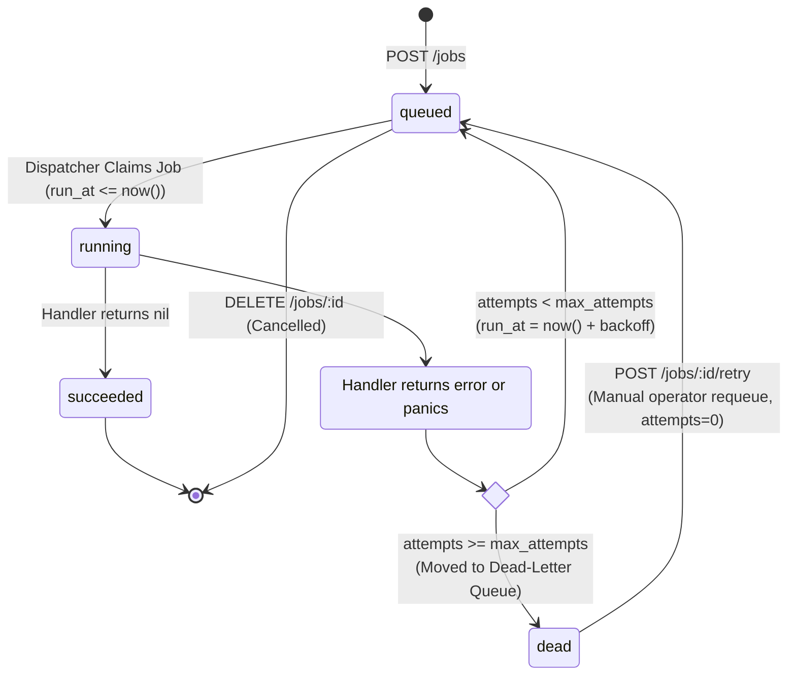

# Go Job Runner

A high-performance, resilient asynchronous job processing engine built in Go and backed by PostgreSQL. Designed to demonstrate production-grade concurrency patterns, pessimistic locking (`FOR UPDATE SKIP LOCKED`), bounded backpressure, exponential backoff with jitter, dead-letter queuing, and crash recovery.

---

## 1. System Architecture

```text
client ──(HTTP)──► API Server ──(INSERT)──► [ jobs table ] ◄── Reaper (Crash Recovery)
                                                 ▲
                                                 │ ClaimJob (SKIP LOCKED)
                                                 │
                                            Dispatcher (Poller)
                                                 │
                                                 ▼
                                     [ Buffered Channel Buffer ]
                                                 │ (Backpressure)
                                                 ▼
                                      Worker Pool (N Goroutines)
                                                 │
                                                 ▼ Complete / Retry / Dead
                                           [ jobs table ]
```

```mermaid
flowchart TD
    subgraph Ingress["Client Layer"]
        Client["HTTP Client (curl / SDK)"]
    end

    subgraph Service["Job Runner Service (Go Binary)"]
        API["Gin REST API (Port 8080)"]
        Disp["Dispatcher Goroutine<br/>(Single Poller)"]
        Ch{{"Buffered Channel<br/>Cap: WorkerCount * 2<br/>(Backpressure)"}}
        Reaper["Crash Reaper<br/>(Visibility Timeout Sweep)"]
        
        subgraph Pool["Worker Pool (N Goroutines)"]
            W1["Worker 0"]
            W2["Worker 1"]
            WN["Worker N..."]
        end
    end

    subgraph Storage["PostgreSQL 16+ Database"]
        DB[("Table: jobs<br/>- Partial Index: jobs_ready_idx<br/>- Status: ENUM")]
    end

    Client -->|POST /jobs, GET /jobs| API
    API -->|INSERT status='queued'| DB
    Disp -->|ClaimJob (FOR UPDATE SKIP LOCKED)| DB
    Disp -->|Push claimed job| Ch
    Ch -->|Consume job| W1
    Ch -->|Consume job| W2
    Ch -->|Consume job| WN
    W1 -->|CompleteJob / RetryJob / MarkJobDead| DB
    W2 -->|CompleteJob / RetryJob / MarkJobDead| DB
    WN -->|CompleteJob / RetryJob / MarkJobDead| DB
    Reaper -->|RequeueStuckJobs (locked_at < threshold)| DB
```

---

## 2. Job Lifecycle State Machine



---

## 3. Quickstart

### Prerequisites
- [Go 1.22+](https://go.dev/dl/)
- [Docker & Docker Compose](https://www.docker.com/)
- [Goose](https://github.com/pressly/goose) migration tool
- [sqlc](https://sqlc.dev/) (optional, for regenerating SQL)

### Running the Application

1. **Start PostgreSQL:**
   ```bash
   make up
   # or: docker compose up -d
   ```

2. **Run Database Migrations:**
   ```bash
   make migrate
   # or: goose -dir migrations postgres "postgres://postgres@localhost:5432/jobrunner?sslmode=disable" up
   ```

3. **Start the Job Runner Service:**
   ```bash
   make run
   # or: go run ./cmd/jobrunner
   ```

The HTTP server will start on `http://localhost:8080`.

---

## 4. API Reference & Curl Examples

### 1. Health & Database Connectivity
```bash
curl -i http://localhost:8080/healthz
```
**Response (`200 OK`):**
```json
{
  "database": "connected",
  "status": "healthy"
}
```

---

### 2. Submit a Job (`POST /jobs`)
Jobs are validated against registered types (`echo`, `sleep`, `fail_randomly`). Accepted jobs return `202 Accepted` immediately while processing occurs in the background.

#### Fast Echo Job
```bash
curl -i -X POST http://localhost:8080/jobs \
  -H "Content-Type: application/json" \
  -d '{
    "type": "echo",
    "payload": {"message": "Hello background worker!"},
    "max_attempts": 3
  }'
```

#### Sleep Job (Simulates Long-Running Task)
```bash
curl -i -X POST http://localhost:8080/jobs \
  -H "Content-Type: application/json" \
  -d '{
    "type": "sleep",
    "payload": {"seconds": 5},
    "max_attempts": 3
  }'
```

#### Flaky Job (Simulates Transient Failures & Retries)
```bash
curl -i -X POST http://localhost:8080/jobs \
  -H "Content-Type: application/json" \
  -d '{
    "type": "fail_randomly",
    "payload": {"fail_percentage": 75},
    "max_attempts": 5
  }'
```

**Response (`202 Accepted`):**
```json
{
  "id": 1,
  "type": "echo",
  "payload": {"message": "Hello background worker!"},
  "status": "queued",
  "attempts": 0,
  "max_attempts": 3,
  "run_at": "2026-11-05T15:00:00Z",
  "created_at": "2026-11-05T15:00:00Z",
  "updated_at": "2026-11-05T15:00:00Z"
}
```

---

### 3. Get Job by ID (`GET /jobs/:id`)
```bash
curl -i http://localhost:8080/jobs/1
```
**Response (`200 OK`):**
```json
{
  "id": 1,
  "type": "echo",
  "payload": {"message": "Hello background worker!"},
  "status": "succeeded",
  "attempts": 1,
  "max_attempts": 3,
  "run_at": "2026-11-05T15:00:00Z",
  "created_at": "2026-11-05T15:00:00Z",
  "updated_at": "2026-11-05T15:00:01Z"
}
```

---

### 4. List Jobs with Filters & Pagination (`GET /jobs`)
Filter by `status` (`queued`, `running`, `succeeded`, `failed`, `dead`) and/or `type`.
```bash
curl -i "http://localhost:8080/jobs?status=dead&limit=10&offset=0"
```
**Response (`200 OK`):**
```json
{
  "count": 1,
  "limit": 10,
  "offset": 0,
  "jobs": [
    {
      "id": 42,
      "type": "fail_randomly",
      "payload": {"fail_percentage": 100},
      "status": "dead",
      "attempts": 5,
      "max_attempts": 5,
      "last_error": "random simulated failure (probability: 100%)",
      "created_at": "2026-11-05T14:50:00Z",
      "updated_at": "2026-11-05T14:55:00Z"
    }
  ]
}
```

---

### 5. Manually Requeue a Dead Job (`POST /jobs/:id/retry`)
Resets a `dead` job back to `queued` with `attempts = 0` and clears error logs.
```bash
curl -i -X POST http://localhost:8080/jobs/42/retry
```
**Response (`200 OK`):**
```json
{
  "message": "job requeued successfully",
  "job": {
    "id": 42,
    "type": "fail_randomly",
    "status": "queued",
    "attempts": 0,
    "max_attempts": 5
  }
}
```

---

### 6. Cancel a Queued Job (`DELETE /jobs/:id`)
Cancels a job if and only if it is still in `queued` status.
```bash
curl -i -X DELETE http://localhost:8080/jobs/42
```
**Response (`200 OK`):**
```json
{
  "message": "job cancelled successfully",
  "job": { "id": 42, "status": "queued" }
}
```

---

## 5. Failure Modes & Resiliency

| Failure Scenario | What Happens | System Defense Mechanism |
|---|---|---|
| **Worker Process Dies Mid-Job (`kill -9` / OOM)** | The job remains locked in `status = 'running'`. | The **Reaper** sweeps periodically. Any job with `locked_at` older than threshold (5m) is rescued back to `status = 'queued'` with `locked_at = NULL`. |
| **Downstream Outage / API Downtime** | Handler returns errors on consecutive attempts. | **Exponential Backoff with Jitter** delays retries ($base \times 2^{attempt} + jitter$). The job is rescheduled into the future via `run_at = now() + backoff` without blocking worker threads. |
| **Poison-Pill Input (Permanent Error)** | Handler consistently errors on every retry. | When `attempts >= max_attempts`, the job transitions to `status = 'dead'` (**Dead-Letter Queue**). Workers stop retrying it, and operators inspect `last_error`. |
| **Database Network Blip** | Dispatcher or API queries fail temporarily. | Database connection pool (`pgxpool`) handles reconnection. Dispatcher backs off for 1 second before retrying. `/healthz` reports `503`. |
| **Server Shutdown (`SIGTERM` / `Ctrl+C`)** | Graceful shutdown initiates. | HTTP server stops accepting requests $\to$ Dispatcher stops claiming $\to$ Channel is closed $\to$ In-flight workers finish via `sync.WaitGroup` with a 30s deadline $\to$ Zero jobs lost. |

---

## 6. Core Conceptual Questions & Answers

### 1. Why is `SELECT` then `UPDATE` unsafe for claiming jobs, and how does `SKIP LOCKED` fix it?
A separate `SELECT` followed by `UPDATE` creates a classic race condition: two workers can select the exact same `queued` row simultaneously before either worker updates its status to `running`. Both workers will claim and execute the same job, causing duplicate processing.

PostgreSQL's `FOR UPDATE SKIP LOCKED` allows an atomic claim:
```sql
UPDATE jobs SET status = 'running', locked_at = now(), locked_by = $1 ...
WHERE id = (
    SELECT id FROM jobs
    WHERE status = 'queued' AND run_at <= now()
    ORDER BY run_at
    FOR UPDATE SKIP LOCKED
    LIMIT 1
)
RETURNING *;
```
`FOR UPDATE` locks the selected row with an exclusive lock. If another concurrent transaction is already locking that row, `SKIP LOCKED` instructs PostgreSQL to skip it immediately and lock the next eligible row. Workers never block each other, and jobs are claimed with 100% collision-free concurrency.

### 2. What happens to a job if the process crashes right after claiming it?
If a worker crashes abruptly (e.g. `kill -9` or a power outage), the job remains in PostgreSQL with `status = 'running'` and `locked_by = <worker_id>`. Because the worker process is dead, it will never complete the task or clear the lock.

Our **Crash Reaper** solves this: it periodically sweeps for jobs where `status = 'running'` and `locked_at < now() - threshold` (e.g. 5 minutes). When found, the reaper resets them to `status = 'queued'` and clears the lock fields so another healthy worker can pick them up.

### 3. Why does a buffered channel give you backpressure, and what happens if it's unbuffered?
- **With a buffered channel** (`make(chan Job, workerCount * 2)`): The Dispatcher claims jobs and buffers them in memory. Once the buffer fills up (e.g. all workers are busy with slow tasks), the dispatcher's send operation `jobChan <- job` **blocks**. The dispatcher stops querying PostgreSQL until a worker finishes and frees a slot. This bounds memory consumption and prevents out-of-memory (OOM) crashes under heavy load.
- **With an unbuffered channel** (`make(chan Job)`): The dispatcher blocks on *every single job* until an idle worker takes it directly. This removes the small buffer smoothing out bursty arrivals, causing the dispatcher to stall between every claim.

### 4. Why add jitter to backoff?
Pure exponential backoff ($base \times 2^{attempt}$) causes all jobs that failed during the same outage to retry at the exact same synchronized intervals ($T=1s, 2s, 4s, 8s$). When they all retry simultaneously, they hit the recovering service in synchronized waves (the **Thundering Herd Problem**), knocking it offline again.

Adding randomized jitter decorrelates retry schedules across workers, spreading the retry load smoothly over a time window and allowing downstream dependencies to recover.

### 5. What is the difference between `context` cancellation and `sync.WaitGroup` in shutdown?
- **`context.Context`** is a **downward notification mechanism**: It signals child goroutines that the operation should be aborted (e.g. telling the Dispatcher to stop polling).
- **`sync.WaitGroup`** is an **upward coordination mechanism**: It lets parent goroutines wait until all child worker goroutines have finished executing their in-flight tasks and returned.

During graceful shutdown, you use context cancellation to stop producers (dispatcher/HTTP), but you wait on `sync.WaitGroup` to let consumers (workers) finish their current work cleanly.

### 6. Why must job handlers be idempotent?
Because of crash recovery and visibility timeouts, a worker might complete 99% of a job's task (e.g. charge a card, write a file) and crash immediately before updating PostgreSQL to `succeeded`. The Reaper will detect the abandoned lock and reschedule the job, causing another worker to execute it again.

This guarantee is known as **At-Least-Once Delivery**. To prevent duplicate side effects (e.g. double-billing a user), handlers must be **idempotent** (using idempotency keys, unique constraints, or UPSERT statements) so running a job more than once produces the exact same result.

### 7. What does the `-race` flag find, and what bugs did it find in your code?
Go's `-race` flag instruments binaries with ThreadSanitizer to detect **data races** at runtime—situations where multiple goroutines access the same memory location concurrently and at least one access is a write without synchronization.

During testing, `-race` verified that our concurrent claim test harness used thread-safe primitives (`sync.Map`, `sync/atomic`) rather than a standard Go `map` (which panics on concurrent writes). It also proved that the worker pool's handler registry correctly synchronizes reads and writes using `sync.RWMutex`.

---

## 7. Development & Testing Commands

```bash
# Run full integration test suite serially
make test

# Run static analysis
make vet

# Regenerate SQLC queries
make sqlc

# Compile executable
make build

# Clean binaries
make clean
```
