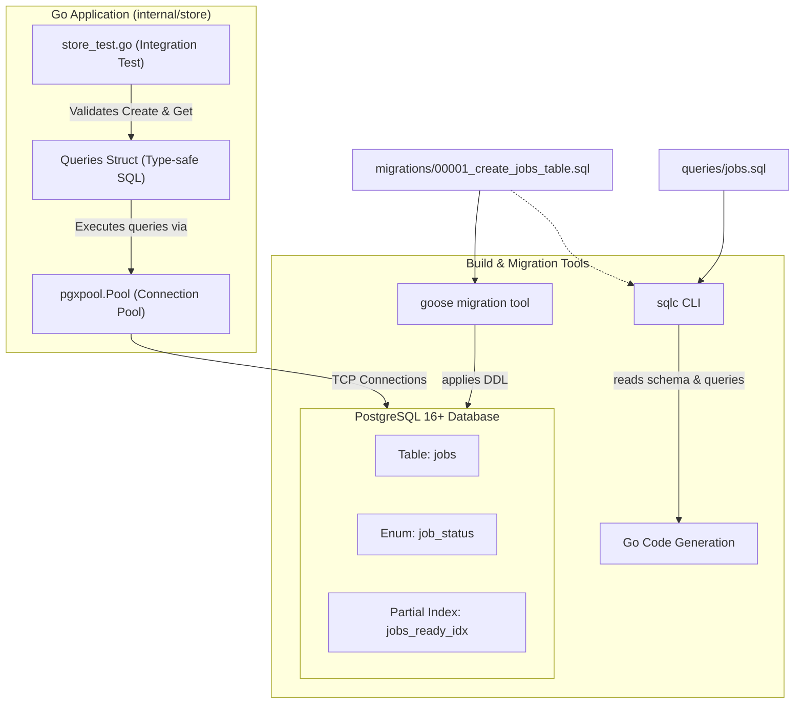

# Phase 1: Database Schema & Migrations — Learning Guide

Welcome to the learning companion for **Phase 1: Database Foundation**. 

This document explains every design decision, file, database concept, and architectural pattern implemented in this phase. Use this guide to deeply understand *why* things were built this way, not just *how* the code looks.

---

## 1. System Architecture & Flow

In Phase 1, our goal was to build a reliable, type-safe persistence layer for the job runner. Before any background worker or HTTP API can operate, we must guarantee:
1. State is durable in a relational database (PostgreSQL).
2. The schema enforces strict lifecycle invariants.
3. Our Go application speaks to the database without runtime type errors or connection exhaustion.

### Architecture Diagram



### Data Flow in Phase 1

1. **Migration Time**: `goose` runs [00001_create_jobs_table.sql](file:///c:/Users/Student4/OneDrive/Documents/0%20-%20projects/go-backend-labs/01-job-runner/migrations/00001_create_jobs_table.sql) against Postgres. The `job_status` enum, `jobs` table, and partial index `jobs_ready_idx` are established.
2. **Compile Time**: `sqlc` parses [00001_create_jobs_table.sql](file:///c:/Users/Student4/OneDrive/Documents/0%20-%20projects/go-backend-labs/01-job-runner/migrations/00001_create_jobs_table.sql) and [queries/jobs.sql](file:///c:/Users/Student4/OneDrive/Documents/0%20-%20projects/go-backend-labs/01-job-runner/queries/jobs.sql), validating the SQL against the schema. It generates Go types ([models.go](file:///c:/Users/Student4/OneDrive/Documents/0%20-%20projects/go-backend-labs/01-job-runner/internal/store/models.go)) and database access methods ([jobs.sql.go](file:///c:/Users/Student4/OneDrive/Documents/0%20-%20projects/go-backend-labs/01-job-runner/internal/store/jobs.sql.go)).
3. **Runtime**: The Go app calls `store.NewPool()` to open a configured connection pool (`*pgxpool.Pool`). The app wraps it with `store.New(pool)` to execute queries safely.

---

## 2. File-by-File Breakdown

### `docker-compose.yml`
- **File path:** [`docker-compose.yml`](file:///c:/Users/Student4/OneDrive/Documents/0%20-%20projects/go-backend-labs/01-job-runner/docker-compose.yml)
- **Purpose:** Defines a local, reproducible PostgreSQL container for development and integration testing.
- **What it does:** Launches PostgreSQL 16 on alpine Linux, exposes port `5432`, mounts a named persistent volume (`postgres_data`), and configures a Docker healthcheck using `pg_isready`.
- **Important components:**
  - `healthcheck`: Ensures other containers or local scripts know when Postgres is ready to accept TCP traffic, not just when the container process starts.
  - `volumes: postgres_data`: Retains database rows across container restarts so test data or local state isn't wiped out unexpectedly.
- **Dependencies:** Interacts with Docker / Docker Compose engine.
- **Why this approach:** Containerizing external dependencies guarantees that every developer and CI pipeline runs an identical Postgres version with identical default configurations.

---

### `migrations/00001_create_jobs_table.sql`
- **File path:** [`migrations/00001_create_jobs_table.sql`](file:///c:/Users/Student4/OneDrive/Documents/0%20-%20projects/go-backend-labs/01-job-runner/migrations/00001_create_jobs_table.sql)
- **Purpose:** Defines the initial database schema (DDL) and supports forward and backward schema evolution.
- **What it does:**
  1. Creates the custom PostgreSQL enum `job_status`.
  2. Creates the `jobs` table with tracking timestamps, retry counters, locking fields, and JSON payload.
  3. Creates the partial index `jobs_ready_idx`.
  4. Provides a rollback (`-- +goose Down`) script to drop the table and type cleanly.
- **Important components:**
  ```sql
  CREATE TYPE job_status AS ENUM ('queued', 'running', 'succeeded', 'failed', 'dead');
  ```
  ```sql
  CREATE TABLE jobs (
      id            BIGSERIAL PRIMARY KEY,
      type          TEXT        NOT NULL,
      payload       JSONB       NOT NULL DEFAULT '{}',
      status        job_status  NOT NULL DEFAULT 'queued',
      attempts      INT         NOT NULL DEFAULT 0,
      max_attempts  INT         NOT NULL DEFAULT 5,
      run_at        TIMESTAMPTZ NOT NULL DEFAULT now(),
      locked_at     TIMESTAMPTZ,
      locked_by     TEXT,
      last_error    TEXT,
      created_at    TIMESTAMPTZ NOT NULL DEFAULT now(),
      updated_at    TIMESTAMPTZ NOT NULL DEFAULT now()
  );
  ```
  ```sql
  CREATE INDEX jobs_ready_idx ON jobs (run_at) WHERE status = 'queued';
  ```
- **How it works:** Migration runners like `goose` read the `-- +goose Up` annotation and execute the statements within a transaction, tracking applied version numbers in a `goose_db_version` table.
- **Dependencies:** Read by `goose` for runtime migrations and by `sqlc` to understand the database schema.
- **Why this approach:** Never write implicit or manual database schemas. Version-controlled SQL migration scripts make database changes deterministic, reviewable in Git, and reversible.

---

### `sqlc.yaml`
- **File path:** [`sqlc.yaml`](file:///c:/Users/Student4/OneDrive/Documents/0%20-%20projects/go-backend-labs/01-job-runner/sqlc.yaml)
- **Purpose:** Configures the `sqlc` compiler.
- **What it does:** Directs `sqlc` to parse our migration directory (`migrations/`) as the source schema, read query definitions from `queries/`, output generated Go code into package `store` (`internal/store/`), and target the modern `pgx/v5` driver.
- **Important components:**
  - `engine: "postgresql"`: Activates PostgreSQL dialect parsing (supports Postgres enums, JSONB, TIMESTAMPTZ).
  - `sql_package: "pgx/v5"`: Directs `sqlc` to generate code using native `pgx/v5` interfaces rather than the older standard library `database/sql`.
- **Dependencies:** Used by the `sqlc` CLI tool.
- **Why this approach:** Centralizes SQL generation configuration in a single, versioned configuration file.

---

### `queries/jobs.sql`
- **File path:** [`queries/jobs.sql`](file:///c:/Users/Student4/OneDrive/Documents/0%20-%20projects/go-backend-labs/01-job-runner/queries/jobs.sql)
- **Purpose:** Houses the raw, parameterized SQL queries needed by the application.
- **What it does:** Defines queries with `sqlc` annotations:
  - `-- name: CreateJob :one`: Inserts a job and returns the newly created record via `RETURNING *`.
  - `-- name: GetJobByID :one`: Looks up a job by its primary key.
  - `-- name: ListJobs :many`: Lists jobs ordered by `id DESC` with `LIMIT` and `OFFSET`.
  - `-- name: ListJobsByStatus :many`: Lists jobs filtering by `status`.
  - `-- name: CancelJob :one`: Deletes a job only if it is currently `queued`.
- **How it works:** `sqlc` reads the annotations (`:one`, `:many`, `:exec`) to determine the return signature of each generated Go method.
- **Dependencies:** Consumed by `sqlc` to generate `internal/store/jobs.sql.go`.
- **Why this approach:** Keeps SQL in native `.sql` files where editors provide syntax highlighting, formatting, and linting. Developers write pure SQL instead of string concatenation in Go code.

---

### `internal/store/models.go` (Generated)
- **File path:** [`internal/store/models.go`](file:///c:/Users/Student4/OneDrive/Documents/0%20-%20projects/go-backend-labs/01-job-runner/internal/store/models.go)
- **Purpose:** Go representations of PostgreSQL types and tables.
- **What it does:**
  - Defines the `JobStatus` type as a Go string, with constants for each enum variant (`JobStatusQueued`, `JobStatusRunning`, etc.).
  - Implements `driver.Valuer` and `sql.Scanner` interfaces so `JobStatus` can be written to and read from Postgres seamlessly.
  - Defines the `Job` struct mapping 1-to-1 with table columns using `pgtype` primitives (`pgtype.Timestamptz`, `pgtype.Text`).
- **Dependencies:** Used across the entire backend wherever job data is processed.
- **Why this approach:** Eliminates manual struct maintenance and synchronization bugs between Go code and database tables.

---

### `internal/store/jobs.sql.go` (Generated)
- **File path:** [`internal/store/jobs.sql.go`](file:///c:/Users/Student4/OneDrive/Documents/0%20-%20projects/go-backend-labs/01-job-runner/internal/store/jobs.sql.go)
- **Purpose:** Type-safe database access methods.
- **What it does:** Implements methods on the `Queries` struct (`CreateJob`, `GetJobByID`, `ListJobs`, `CancelJob`). Each method binds parameters to PostgreSQL positional arguments (`$1`, `$2`), executes the query through a `DBTX` interface, scans the rows into structs, and returns errors.
- **Dependencies:** Interacts with `internal/store/db.go` and `pgx/v5`.
- **Why this approach:** Writing boilerplate `Scan(&row.ID, &row.Type, ...)` by hand is tedious and error-prone. `sqlc` generates this with zero reflection and optimal performance.

---

### `internal/store/db.go` (Generated)
- **File path:** [`internal/store/db.go`](file:///c:/Users/Student4/OneDrive/Documents/0%20-%20projects/go-backend-labs/01-job-runner/internal/store/db.go)
- **Purpose:** Core abstraction layer for database execution.
- **What it does:** Defines the `DBTX` interface (`Exec`, `Query`, `QueryRow`). Both `*pgxpool.Pool` and `pgx.Tx` (transactions) satisfy this interface, which means all generated queries can run either directly against the connection pool or inside an atomic transaction without changing query code.
- **Dependencies:** Foundation for `Queries`.

---

### `internal/store/pool.go`
- **File path:** [`internal/store/pool.go`](file:///c:/Users/Student4/OneDrive/Documents/0%20-%20projects/go-backend-labs/01-job-runner/internal/store/pool.go)
- **Purpose:** Production-grade PostgreSQL connection pool factory.
- **What it does:**
  - Defines `PoolConfig` for tuning pool parameters (`MaxConns`, `MinConns`, `MaxConnIdleTime`, `MaxConnLifetime`).
  - Parses the connection string via `pgxpool.ParseConfig`.
  - Applies defaults (10 max connections, 2 minimum warm idle connections).
  - Instantiates the pool and executes a ping with a 3-second timeout to verify real connectivity before returning.
- **How it works:**
  ```go
  pool, err := pgxpool.NewWithConfig(ctx, pgxCfg)
  ...
  pingCtx, cancel := context.WithTimeout(ctx, 3*time.Second)
  defer cancel()
  if err := pool.Ping(pingCtx); err != nil { ... }
  ```
- **Dependencies:** Directly uses `github.com/jackc/pgx/v5/pgxpool`.
- **Why this approach:** Failing fast at startup (via `Ping`) prevents the server from booting into a broken state where requests immediately fail. Connection pooling prevents connection starvation and TCP socket exhaustion.

---

### `internal/store/store_test.go`
- **File path:** [`internal/store/store_test.go`](file:///c:/Users/Student4/OneDrive/Documents/0%20-%20projects/go-backend-labs/01-job-runner/internal/store/store_test.go)
- **Purpose:** Verifies that the database layer works end-to-end against a real PostgreSQL instance.
- **What it does:**
  1. Connects to Postgres using `store.NewPool()`.
  2. Inserts a new job record with type `echo`, JSON payload `{"message": "hello world"}`, and max attempts `3`.
  3. Asserts the returned `ID` is positive, status defaults to `queued`, and attempts start at `0`.
  4. Reads the record back using `GetJobByID()` and asserts payload and metadata match.
- **How to run:**
  ```bash
  go test -v ./internal/store/...
  ```
- **Dependencies:** Interacts with Postgres and the `store` package.
- **Why this approach:** Unit tests with mock databases often pass while failing against the actual database engine due to subtle SQL dialect or type mapping differences. Testing against real Postgres gives 100% confidence.

---

## 3. Core Backend Concepts Explained

### 1. PostgreSQL Schema Design for Queues

Unlike traditional CRUD apps where rows represent static entities (like users or products), a job queue table represents **state machines in motion**.

```
[queued] ──(claimed)──► [running] ──(completed)──► [succeeded]
                             │
                      (error / retry)
                             ▼
                     [queued (delayed)]
                             │
                      (attempts >= max)
                             ▼
                          [dead]
```

To support this lifecycle reliably, every column has a specific role:
- `attempts` & `max_attempts`: Track execution history to prevent infinite failure loops.
- `run_at`: Decouples creation time from execution time. When retrying a job with backoff (e.g., wait 30 seconds), we do not pause a thread; we simply update `run_at = now() + 30s`.
- `locked_at` & `locked_by`: Record which worker instance owns the job and when the lock began. If a worker process crashes, this allows the system to detect abandoned jobs (Phase 6).
- `payload JSONB`: Stores arbitrary handler inputs without requiring a new database schema for each new job type.

---

### 2. Database Migrations and Why They Matter

#### The Problem Without Migrations
If you manually run SQL commands in `psql` to alter tables:
- Collaborators don't have your schema changes.
- Deployments to staging and production require manual intervention and are error-prone.
- There is no audit history of schema evolution.

#### How Migrations Solve This
Migrations are version-controlled DDL files with sequential identifiers (e.g., `00001_create_jobs_table.sql`).
- **`Up` script**: Applies the incremental change.
- **`Down` script**: Reverses the change if a rollback is needed.
- The migration tool maintains a dedicated table (`goose_db_version`) recording which versions have been executed. It applies only new migrations idempotently.

---

### 3. PostgreSQL Enums vs Text Check Constraints

In our migration, we defined:
```sql
CREATE TYPE job_status AS ENUM ('queued', 'running', 'succeeded', 'failed', 'dead');
```

#### Why use an ENUM?
1. **Type Safety at the Engine Level**: Postgres rejects any insert or update with an invalid status (e.g., `'queud'`) before it touches disk.
2. **Storage Efficiency**: Internally, Postgres stores enums as a 4-byte integer OID rather than storing full text strings across millions of rows.
3. **Explicit Domain Boundaries**: Reading the schema immediately informs developers of every possible job lifecycle state.

---

### 4. Partial Indexes and Their Power in Job Queues

Consider a queue that processes 10,000 jobs per hour:
- After one week, the `jobs` table has **1,680,000 rows**.
- **1,679,950** rows are in `succeeded` or `dead` status.
- Only **50** rows are in `queued` status waiting to be processed.

#### The Problem with a Standard Index
If you run:
```sql
CREATE INDEX idx_jobs_run_at ON jobs (run_at);
```
Postgres indexes all 1.68 million rows. This causes:
- Massive index size in RAM.
- Cache thrashing (active jobs are interspersed among millions of dead jobs).
- Slower `INSERT` and `UPDATE` operations because every finished job must update this index.

#### The Partial Index Solution
```sql
CREATE INDEX jobs_ready_idx ON jobs (run_at) WHERE status = 'queued';
```
The `WHERE status = 'queued'` clause tells Postgres: **only include rows where `status = 'queued'` in the B-Tree index**.
- When a new job is enqueued (`status = 'queued'`), it is inserted into the index.
- When a worker claims the job and sets `status = 'running'`, Postgres **removes it from the index**.
- The index remains microscopic (containing only the ~50 pending jobs), sits permanently in CPU L3/RAM cache, and provides instant lookups.

---

### 5. Type-Safe SQL Generation with SQLC

In Go, there are three common approaches to database interactions:

| Approach | Pros | Cons |
|---|---|---|
| **Heavy ORM (e.g., GORM)** | Quick prototyping | Hides SQL, generates sub-optimal queries, heavy reflection, hard to optimize locking queries like `SKIP LOCKED`. |
| **Raw SQL (`database/sql` / `pgx`)** | Full SQL control | Runtime errors on typos, manual `Scan(&...)` boilerplate, no compile-time verification. |
| **Compiled SQL (`sqlc`)** | **Full SQL control + 100% compile-time type safety + zero reflection** | Requires running `sqlc generate` when queries change. |

With `sqlc`:
1. You write standard SQL in `.sql` files.
2. `sqlc` parses the schema and queries against Postgres engine rules.
3. It emits pure Go structs matching the column types exactly. If you change a column type in a migration, `sqlc` flags broken queries before your application ever builds.

---

### 6. Connection Pooling with `pgxpool`

A database connection is not a lightweight Go pointer; it is a live **TCP connection** backed by an operating system process on the PostgreSQL server.

#### Why We Need a Pool
- Opening a TCP connection involves network roundtrips, TLS negotiation, authentication, and backend process fork/allocation in Postgres (~20–100ms).
- Creating a new connection per incoming HTTP request destroys performance and quickly hits PostgreSQL's `max_connections` limit (causing `FATAL: remaining connection slots are reserved`).

#### How the Pool Operates
[`internal/store/pool.go`](file:///c:/Users/Student4/OneDrive/Documents/0%20-%20projects/go-backend-labs/01-job-runner/internal/store/pool.go) configures:
- `MaxConns (10)`: Bounds the maximum simultaneous connections to Postgres, preventing server overload under high concurrency.
- `MinConns (2)`: Keeps at least 2 connections open and warmed up so initial queries experience zero latency.
- `MaxConnIdleTime (5m)`: Closes excess idle connections after inactivity.
- `MaxConnLifetime (1h)`: Periodically recycles connections to prevent memory bloat or stale socket issues.

---

### 7. Integration Testing Against Real PostgreSQL

In [`internal/store/store_test.go`](file:///c:/Users/Student4/OneDrive/Documents/0%20-%20projects/go-backend-labs/01-job-runner/internal/store/store_test.go), we test directly against a live PostgreSQL instance rather than using an in-memory substitute (like SQLite) or a mock library (`go-sqlmock`).

#### Why avoid SQLite or mocks for queue testing?
- SQLite does not have PostgreSQL's `job_status` ENUM, `JSONB`, or `TIMESTAMPTZ`.
- SQLite does not support `FOR UPDATE SKIP LOCKED` (which is critical in Phase 3).
- Mock libraries only test that you called a method; they do not test that the SQL syntax or constraints actually work.
- Testing against real Postgres ensures what works in test will work in production.

---

## 4. Learning Checklist & Self-Assessment

### Key Takeaways
- [x] Background job tables must model state transitions explicitly (`queued` -> `running` -> `succeeded`/`failed`/`dead`).
- [x] Partial indexes (`WHERE status = 'queued'`) prevent database performance degradation as completed jobs accumulate.
- [x] Migrations keep schema changes repeatable and versioned alongside source code.
- [x] Connection pooling prevents database exhaustion and reduces per-request latency.
- [x] `sqlc` provides type-safe Go bindings directly from raw SQL queries.

### Important Terminology
- **DDL (Data Definition Language):** SQL statements that define database structures (`CREATE TABLE`, `CREATE INDEX`, `ALTER TYPE`).
- **Partial Index:** An index built over a subset of rows defined by a `WHERE` condition.
- **Connection Pool:** A cache of persistent database connections maintained so that connections can be reused for subsequent requests.
- **Idempotence:** An operation that can be applied multiple times without changing the result beyond the initial application.
- **Backpressure:** Resistance or throttling applied when downstream components cannot process incoming load as fast as it arrives.

### Questions You Should Be Able to Answer
1. Why is a partial index on `run_at WHERE status = 'queued'` superior to an index on `run_at` alone?
2. What would happen to the Postgres server if every incoming API request called `pgx.Connect()` directly instead of using `pgxpool.Pool`?
3. How does `sqlc` know what Go type to generate for custom PostgreSQL ENUMs like `job_status`?
4. What is the difference between `-- +goose Up` and `-- +goose Down`?
5. Why is `run_at` configured with `TIMESTAMPTZ` instead of a plain `TIMESTAMP`?

### Areas to Investigate Further
- Explore PostgreSQL's `EXPLAIN (ANALYZE, BUFFERS)` to see how the query planner chooses between sequential scans and partial index scans.
- Read about PostgreSQL's `pg_stat_activity` to observe active connections and their lock states.
- Review the documentation of [jackc/pgx](https://github.com/jackc/pgx) regarding binary format transfers vs text format.

---

*Next Phase Preview: In [Phase 2: REST API & Request Lifecycle](https://github.com/fenet-as/go-job-runner/issues/2), we will build the HTTP server using Gin, structured logging with `log/slog`, and input validation to insert and inspect jobs via `curl`.*
